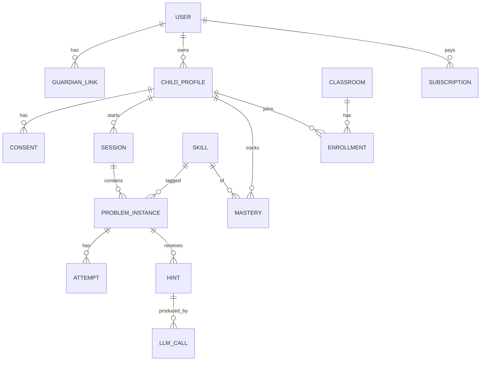

## 8. Veri Modeli

### 8.1 Varlık ilişkileri (özet)



### 8.2 Çekirdek tablolar (PostgreSQL DDL taslağı)

```sql
-- Kullanıcılar (yetişkinler: ebeveyn, öğretmen, admin)
CREATE TABLE users (
  id UUID PRIMARY KEY DEFAULT gen_random_uuid(),
  email CITEXT UNIQUE NOT NULL,
  password_hash TEXT,
  role TEXT NOT NULL CHECK (role IN ('guardian','teacher','admin','moderator')),
  full_name TEXT,
  locale TEXT DEFAULT 'tr-TR',
  email_verified_at TIMESTAMPTZ,
  created_at TIMESTAMPTZ DEFAULT now(),
  deleted_at TIMESTAMPTZ
);

-- Çocuk profilleri (e-posta/telefon TUTULMAZ; takma ad + yaş bandı)
CREATE TABLE child_profiles (
  id UUID PRIMARY KEY DEFAULT gen_random_uuid(),
  guardian_id UUID NOT NULL REFERENCES users(id),
  nickname TEXT NOT NULL,                 -- gerçek ad zorunlu değil
  birth_year SMALLINT NOT NULL,           -- tam doğum tarihi yerine yıl (veri minimizasyonu)
  grade SMALLINT NOT NULL,
  age_band TEXT NOT NULL CHECK (age_band IN ('7-10','11-13','14-17')),
  daily_new_problem_limit SMALLINT DEFAULT 5,
  solution_policy TEXT NOT NULL DEFAULT 'after_attempts_with_notice'
    CHECK (solution_policy IN ('never','after_attempts_with_notice','guardian_only','similar_example_only')),
  privacy_level TEXT NOT NULL DEFAULT 'summary_only'
    CHECK (privacy_level IN ('summary_only','full_transcript')), -- 14+ için varsayılan summary_only
  created_at TIMESTAMPTZ DEFAULT now(),
  deleted_at TIMESTAMPTZ
);

-- Rızalar (sürümlü, kanıt niteliğinde)
CREATE TABLE consents (
  id UUID PRIMARY KEY DEFAULT gen_random_uuid(),
  child_id UUID NOT NULL REFERENCES child_profiles(id),
  guardian_id UUID NOT NULL REFERENCES users(id),
  purpose TEXT NOT NULL,                  -- 'service','analytics','llm_processing','photo_processing'
  policy_version TEXT NOT NULL,
  granted BOOLEAN NOT NULL,
  granted_at TIMESTAMPTZ DEFAULT now(),
  revoked_at TIMESTAMPTZ,
  evidence JSONB                          -- IP hash, user agent, doğrulama yöntemi
);

-- Beceri/kazanım
CREATE TABLE skills (
  id UUID PRIMARY KEY DEFAULT gen_random_uuid(),
  code TEXT UNIQUE NOT NULL,              -- MEB kazanım kodu ⚠️ DOĞRULA
  subject TEXT NOT NULL,
  grade SMALLINT NOT NULL,
  title_tr TEXT NOT NULL,
  prerequisites UUID[] DEFAULT '{}'
);

-- Oturum ve soru
CREATE TABLE sessions (
  id UUID PRIMARY KEY DEFAULT gen_random_uuid(),
  child_id UUID NOT NULL REFERENCES child_profiles(id),
  started_at TIMESTAMPTZ DEFAULT now(),
  ended_at TIMESTAMPTZ
);

CREATE TABLE problem_instances (
  id UUID PRIMARY KEY DEFAULT gen_random_uuid(),
  session_id UUID NOT NULL REFERENCES sessions(id),
  source TEXT CHECK (source IN ('text','photo','curated')),
  raw_input_masked TEXT NOT NULL,         -- PII maskelenmiş
  normalized_problem TEXT,
  hidden_solution JSONB,                  -- şifreli saklama; öğrenciye ASLA dönmez
  verification_status TEXT CHECK (verification_status IN ('verified','unverified','failed')),
  skill_ids UUID[],
  status TEXT DEFAULT 'open',             -- open, solved, abandoned, solution_revealed
  current_hint_level SMALLINT DEFAULT 0,
  created_at TIMESTAMPTZ DEFAULT now(),
  solved_at TIMESTAMPTZ
);

CREATE TABLE attempts (
  id UUID PRIMARY KEY DEFAULT gen_random_uuid(),
  problem_id UUID NOT NULL REFERENCES problem_instances(id),
  student_answer_masked TEXT,
  is_correct BOOLEAN,
  error_pattern TEXT,                     -- misconception kodu
  created_at TIMESTAMPTZ DEFAULT now()
);

CREATE TABLE hints (
  id UUID PRIMARY KEY DEFAULT gen_random_uuid(),
  problem_id UUID NOT NULL REFERENCES problem_instances(id),
  level SMALLINT NOT NULL CHECK (level BETWEEN 0 AND 5),
  content TEXT NOT NULL,
  leak_check JSONB,                       -- {rule_pass, judge_pass, retries}
  helpful BOOLEAN,                        -- öğrenci geri bildirimi
  llm_call_id UUID,
  created_at TIMESTAMPTZ DEFAULT now()
);

-- Beceri ustalığı
CREATE TABLE mastery (
  child_id UUID REFERENCES child_profiles(id),
  skill_id UUID REFERENCES skills(id),
  attempts_count INT DEFAULT 0,
  independent_solves INT DEFAULT 0,
  avg_hint_level NUMERIC(3,2),
  score NUMERIC(5,2),
  updated_at TIMESTAMPTZ DEFAULT now(),
  PRIMARY KEY (child_id, skill_id)
);

-- LLM çağrı kaydı (izlenebilirlik ve maliyet)
CREATE TABLE llm_calls (
  id UUID PRIMARY KEY DEFAULT gen_random_uuid(),
  purpose TEXT NOT NULL,                  -- classify, solve, hint, leak_judge, safety
  provider TEXT NOT NULL,
  model TEXT NOT NULL,
  prompt_version TEXT NOT NULL,
  input_tokens INT, output_tokens INT,
  latency_ms INT,
  cost_usd NUMERIC(10,6),
  status TEXT,
  created_at TIMESTAMPTZ DEFAULT now()
);

CREATE TABLE prompt_versions (
  id TEXT PRIMARY KEY,                    -- 'hint_l2_tr_v3'
  purpose TEXT NOT NULL,
  body TEXT NOT NULL,
  created_by UUID REFERENCES users(id),
  eval_report_id UUID,
  created_at TIMESTAMPTZ DEFAULT now()
);

CREATE TABLE moderation_events (
  id UUID PRIMARY KEY DEFAULT gen_random_uuid(),
  child_id UUID REFERENCES child_profiles(id),
  stage TEXT,                             -- input, output
  category TEXT,                          -- self_harm, sexual, pii, injection, violence, bullying ...
  severity SMALLINT,
  action TEXT,                            -- blocked, redirected, escalated
  reviewed_by UUID, reviewed_at TIMESTAMPTZ,
  created_at TIMESTAMPTZ DEFAULT now()
);

-- Sınıf (öğretmen)
CREATE TABLE classrooms (
  id UUID PRIMARY KEY DEFAULT gen_random_uuid(),
  teacher_id UUID NOT NULL REFERENCES users(id),
  name TEXT NOT NULL,
  join_code TEXT UNIQUE NOT NULL,
  grade SMALLINT
);
CREATE TABLE enrollments (
  classroom_id UUID REFERENCES classrooms(id),
  child_id UUID REFERENCES child_profiles(id),
  guardian_approved BOOLEAN DEFAULT false,   -- ebeveyn onayı olmadan öğretmen veri görmez
  PRIMARY KEY (classroom_id, child_id)
);

-- Abonelik
CREATE TABLE subscriptions (
  id UUID PRIMARY KEY DEFAULT gen_random_uuid(),
  guardian_id UUID NOT NULL REFERENCES users(id),
  plan TEXT NOT NULL,
  status TEXT NOT NULL,
  provider TEXT, provider_ref TEXT,
  current_period_end TIMESTAMPTZ
);

CREATE TABLE audit_log (
  id BIGSERIAL PRIMARY KEY,
  actor_id UUID, action TEXT, target TEXT, meta JSONB,
  created_at TIMESTAMPTZ DEFAULT now()
);
```

### 8.3 Veri yaşam döngüsü

| Veri | Saklama süresi (öneri) | Not |
|---|---|---|
| Çocuk sohbet metni (maskeli) | 12 ay veya ebeveyn silene kadar | `privacy_level` ve rıza ile uyumlu |
| Yüklenen foto | OCR sonrası kısa süre (örn. 24 saat–7 gün) sonra silinir | Yüz/ad içerebilir, kalıcı saklama yok |
| Gizli çözüm | Soru örneği ile birlikte | Şifreli, erişim kısıtlı |
| LLM çağrı kaydı | 90 gün ham, sonra yalnızca toplulaştırılmış | İçerik yerine meta |
| Moderasyon olayları | 12–24 ay | Güvenlik ve yasal gereklilik |
| Hesap silme | İstekten sonra 30 gün içinde kalıcı silme (yasal saklama hariç) | KVKK talepleri |

⚠️ DOĞRULA: Saklama süreleri hukuk danışmanıyla netleştirilmeli.

---

